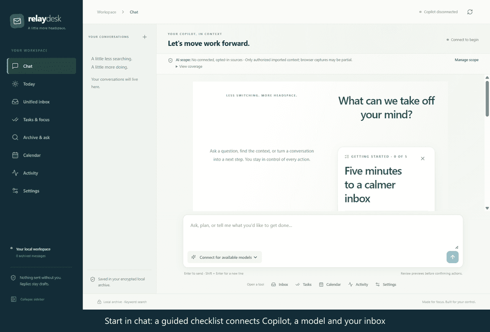
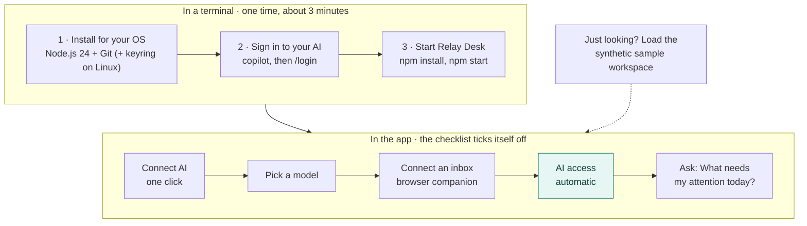
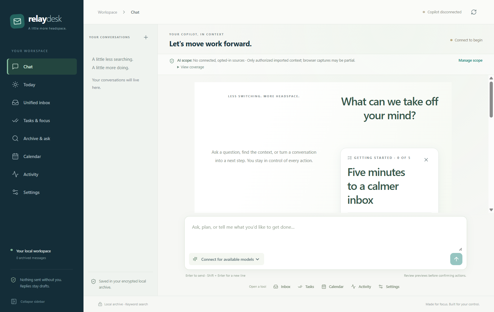
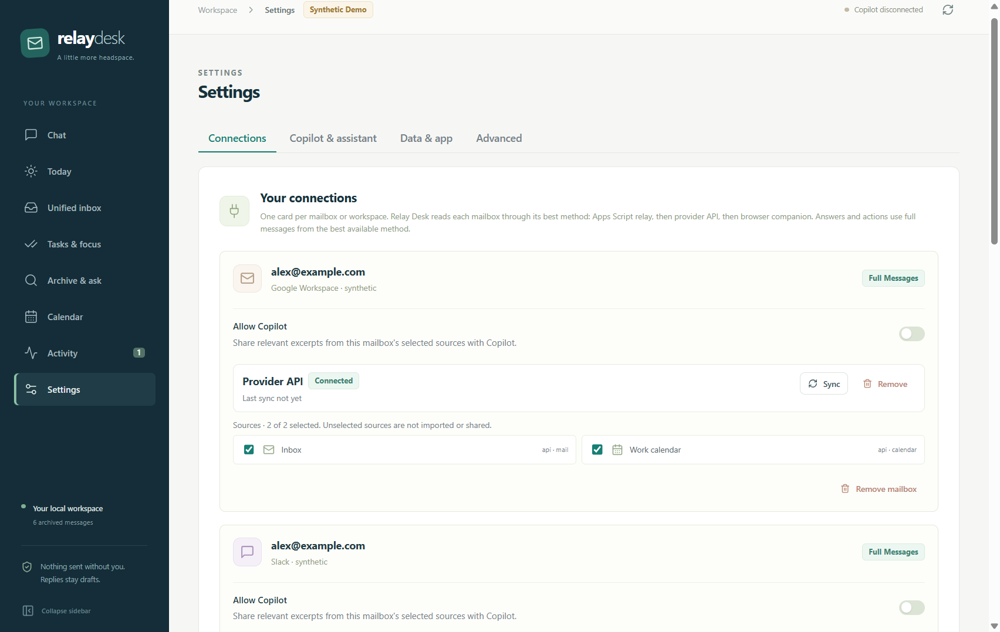
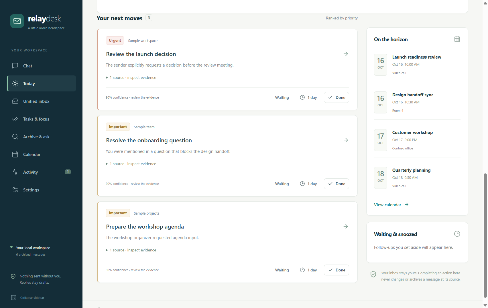
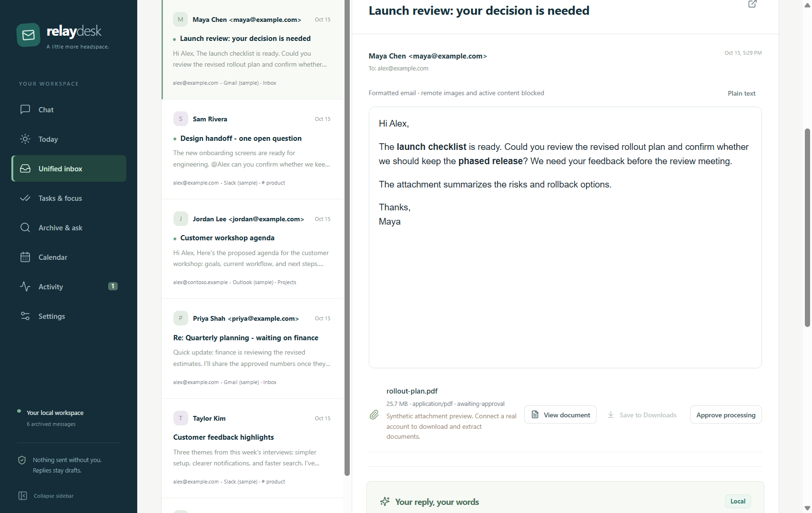
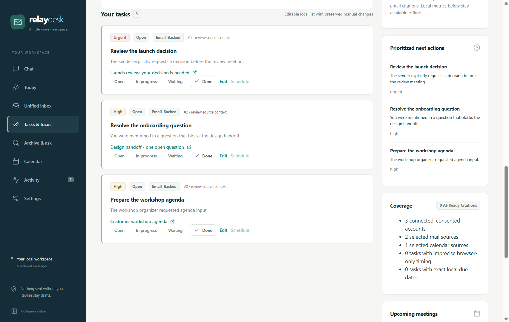
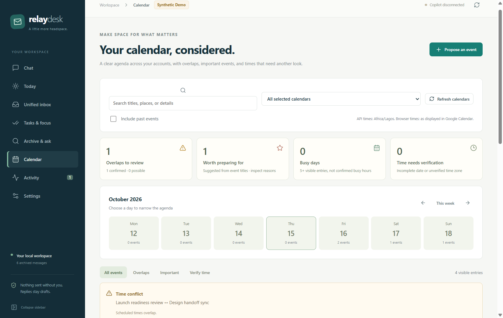
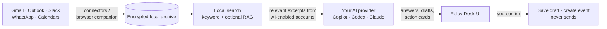

<div align="center">

# Relay Desk

**Your inbox, Slack and calendar in one calm place, with GitHub Copilot, Claude or OpenAI Codex doing the heavy lifting.**

Local-first · Encrypted · Bring your own AI subscription · Windows, macOS and Linux

[](https://github.com/Ai4Innov/relaydesk/actions/workflows/ci.yml)
[](LICENSE)




**[Quick start](#quick-start-3-steps)** · **[What's on by default](#whats-on-by-default)** · **[Screenshots](#see-it)** · **[User guide](docs/user-guide.md)** · **[Getting started (illustrated)](docs/getting-started.md)**

</div>

Relay Desk reads your Gmail, Outlook, Slack, WhatsApp and calendars into an encrypted archive on **your** computer. It tells you what needs attention, drafts replies for you to review, and suggests next actions. It uses the AI subscription you already have, so you don't need a new API key. It **never sends anything on your behalf**.

> Relay Desk is an [Ai4Innov](https://github.com/Ai4Innov) open-source project, licensed under [Apache-2.0](LICENSE). It is independent and **not affiliated with, endorsed by or sponsored by GitHub, Microsoft, Google, Slack, Meta, Anthropic or OpenAI**. You are responsible for complying with your employer's policies and each provider's terms, including the [GitHub Copilot terms](https://docs.github.com/en/site-policy/github-terms/github-terms-for-additional-products-and-features#github-copilot), [Anthropic's terms](https://www.anthropic.com/legal/commercial-terms) and [OpenAI's terms](https://openai.com/policies/).

## Onboarding at a glance



Each checklist step ticks itself off when the app detects it is done. Thanks to **full access by default**, you never have to switch on folders, calendars or AI one account at a time.

## Quick start (3 steps)

You need [Node.js 24](https://nodejs.org/) (`^24.13.0`), Git, and **one** AI provider. The commands below use GitHub Copilot; [Codex and Claude](#ai-providers) work too.

**0. Install the prerequisites for your OS** (skip what you already have; check with `node -v` and `git --version`)

<details open>
<summary><strong>🪟 Windows 10/11</strong> (PowerShell)</summary>

```powershell
winget install --id Git.Git -e
# Node.js 24: run the official "Windows Installer (.msi)" from https://nodejs.org/en/download
# then open a NEW PowerShell window so node, npm and git are on PATH.
# If PowerShell says "running scripts is disabled", allow npm's scripts once:
Set-ExecutionPolicy -Scope CurrentUser RemoteSigned
```

Use the official Node.js build. MSYS2, Cygwin and WSL-from-Windows Node builds can't load the native modules. No keyring setup is needed: the archive key uses Windows DPAPI.
</details>

<details>
<summary><strong>🍎 macOS 13+</strong> (Terminal, Apple silicon or Intel)</summary>

```bash
xcode-select --install          # Git and build tools
# Node.js 24: run the official macOS Installer (.pkg) from https://nodejs.org/en/download
# or, with Homebrew:
brew install node@24 && brew link --overwrite --force node@24
```

On first launch macOS may ask for Keychain access to protect the archive key. Choose **Always Allow**.
</details>

<details>
<summary><strong>🐧 Linux</strong> (Ubuntu 22.04+, Debian 12+, Fedora 39+)</summary>

```bash
# Git, build tools and a Secret Service keyring (required; there is no plaintext fallback)
sudo apt install -y git build-essential python3 gnome-keyring libsecret-1-0      # Debian/Ubuntu
# sudo dnf install -y git gcc-c++ make python3 gnome-keyring libsecret           # Fedora
# Node.js 24 via nvm, so global npm installs don't need sudo
curl -o- https://raw.githubusercontent.com/nvm-sh/nvm/v0.40.8/install.sh | bash
source ~/.nvm/nvm.sh && nvm install 24
```

KDE users can use KWallet instead of GNOME Keyring. The keyring must be unlocked in your desktop session (it normally unlocks at login).
</details>

**1. Sign in to your AI (one time)**. These commands are the same on every OS.

```bash
npm install -g @github/copilot
copilot            # type /login, finish in the browser, then exit
```

**2. Get and start Relay Desk**

```bash
git clone https://github.com/Ai4Innov/relaydesk.git
cd relaydesk
npm install
npm run doctor     # optional: checks native prerequisites for your OS
npm start
```

**3. Follow the in-app checklist.** Click **Connect Copilot**, pick a model, then click **Connect an inbox**. The quickest option is the browser companion, which uses the Gmail and Calendar tabs you already have open. Then ask *"What needs my attention today?"*

<table><tr>
<td width="50%"><br><sub>The checklist guides you and ticks itself off.</sub></td>
<td width="50%"><br><sub>Switch AI provider or model at any time.</sub></td>
</tr></table>

Stuck? See the illustrated, per-OS [Getting started guide](docs/getting-started.md) and its troubleshooting section.

## What's on by default

Relay Desk is set up so that it just works once an inbox is connected. You can change every item below in **Settings**.

| | Default | Change it in |
| --- | --- | --- |
| 🟢 **Full access by default**: new accounts are imported, all of their folders, channels and calendars are selected, and they are shared with your AI | **On** | Settings → AI & assistant (global), or the **Allow AI** and source toggles on each account in Settings → Connections |
| 🟢 Background AI: prioritizes new mail and pre-drafts replies | **On**, capped at 20 runs per day | Settings → AI & assistant |
| 🟢 Background browser refresh: keeps capturing open Gmail and Calendar tabs | **On** | Settings → Connections |
| 🟢 **Approve automatically**: large or unknown-size attachments, costly extraction, and calendar changes without attendees | **On** (size, parser and sandbox limits still apply) | Activity & approvals |
| 🟡 Shell commands, web requests and reading files outside the workspace | **Ask each time** | Settings → AI & assistant |
| 🟡 Saving a draft to Gmail or Outlook, and calendar changes that would notify attendees | **You confirm each one** | — |
| 🟡 WhatsApp chats (personal conversations with third parties) | **Opt-in per chat** | Settings → Connections |
| 🔴 Sending email, posting to Slack, deleting mail or events | **Never** | Not possible |

> **Why some items still ask:** emails can contain text written to manipulate an AI ("prompt injection"). Actions with side effects therefore always need your click, even with full access on. Relevant excerpts from AI-enabled accounts go to your AI provider (GitHub, OpenAI or Anthropic). Everything else stays encrypted on your computer. See [privacy and permissions](docs/privacy-and-permissions.md).

## See it

| | |
| --- | --- |
|  **Guided setup** in the chat |  **Today:** your next moves, ranked, with reasons |
|  **Unified inbox** across accounts |  **Tasks and focus reports** from your messages |
|  **Calendar** with overlap detection |  **Choose Copilot, Codex or Claude**, any model |

## What it does

- **One inbox for many channels:** Gmail (browser companion, Apps Script relay, Gmail API or Playwright), Microsoft 365, Slack, WhatsApp Web, and Google and Microsoft calendars.
- **Chat agent with reviewed actions:** finds what needs attention, cites evidence, drafts replies, creates tasks and focus reports, and writes DOCX, XLSX and PPTX files. Every write is a card you confirm.
- **Folders and shared links as knowledge:** add a local folder or an "Anyone with the link" Google Drive, Docs, Dropbox or OneDrive link in **Settings → Connections**. The assistant can then search and quote your PDFs, Office files and notes, read-only.
- **Your AI, your choice:** GitHub Copilot or OpenAI Codex with your existing subscription sign-in, or Claude with your own key. Pick any available model, per message.
- **Local-first and encrypted:** SQLCipher archive, encrypted attachments and an OS-protected key (DPAPI, Keychain or Secret Service), plus local keyword and optional semantic search.



## AI providers

Choose the provider in **Settings → AI & assistant** and switch at any time. Each provider remembers its own model.

| Provider | Sign-in | One-time setup | Billing |
| --- | --- | --- | --- |
| **GitHub Copilot** (default) | Copilot CLI login, no API key | `npm install -g @github/copilot`, then `copilot` → `/login` | Your Copilot plan |
| **OpenAI Codex** | Codex CLI login with ChatGPT, no API key | `npm install -g @openai/codex`, then `codex login` | Your ChatGPT plan |
| **Claude** | Your Anthropic API key | Paste a key from the [Anthropic Console](https://console.anthropic.com/) into Settings | Per token, to Anthropic |

All three get the same tools and the same approval rules. Claude needs a key because Anthropic does not allow third-party apps to offer Claude.ai subscription sign-in. Details are in the [user guide](docs/user-guide.md#chat-first-workspace) and [chat agent docs](docs/chat-agent.md).

## Platforms

| Platform | Status | Archive key protected by | `npm run make` output |
| --- | --- | --- | --- |
| Windows 10/11 x64 | Primary development platform | DPAPI | ZIP |
| macOS 13+ (arm64/x64) | Supported; built and tested in CI | Keychain | ZIP (unsigned `.app`) |
| Linux x64 | Supported; built and tested in CI | Secret Service (GNOME Keyring/KWallet) | `.deb`, ZIP |

## Documentation

| I want to… | Read |
| --- | --- |
| Install step by step on my OS | [Getting started](docs/getting-started.md) |
| Learn every feature (chat, inbox, refresh, tasks, calendar, archive) | [User guide](docs/user-guide.md) |
| Understand what data goes where | [Privacy and permissions](docs/privacy-and-permissions.md) |
| Set up the browser companion or WhatsApp | [Browser mode](docs/browser-mode.md) |
| Read full Gmail without Google Cloud setup | [Apps Script relay](apps-script/gmail-relay/README.md) |
| Connect the Gmail API, Microsoft 365 or Slack | [Provider setup](docs/provider-setup.md) |
| Check supported attachment formats | [Attachment support](docs/attachment-support.md) |
| Hack on the code | [Architecture](docs/architecture.md), [development commands](docs/user-guide.md#development-commands), [CONTRIBUTING](CONTRIBUTING.md) |

## Repository layout

| Path | Contents |
| --- | --- |
| `src/main` | Electron main process: orchestration, commands, AI providers, connectors, storage, retrieval, attachments, browser bridge. |
| `src/preload` | Narrow, validated IPC bridge. |
| `src/renderer` | React UI (Chat, Inbox, Calendar, Tasks, Settings). |
| `src/shared` | Contracts and schemas shared between processes. |
| `browser-extension` | Chrome/Edge companion (Manifest V3). |
| `apps-script/gmail-relay` | Optional Google Apps Script that exports Gmail for the relay connector. |
| `tests`, `docs` | Vitest/Playwright tests; documentation and screenshots. |

## Contributing, security and license

Contributions are welcome. Read [CONTRIBUTING.md](CONTRIBUTING.md) and the [Code of Conduct](CODE_OF_CONDUCT.md). Report vulnerabilities privately as described in [SECURITY.md](SECURITY.md), never in public issues.

Relay Desk is licensed under the [Apache License 2.0](LICENSE). Third-party notices are in [NOTICE](NOTICE).
