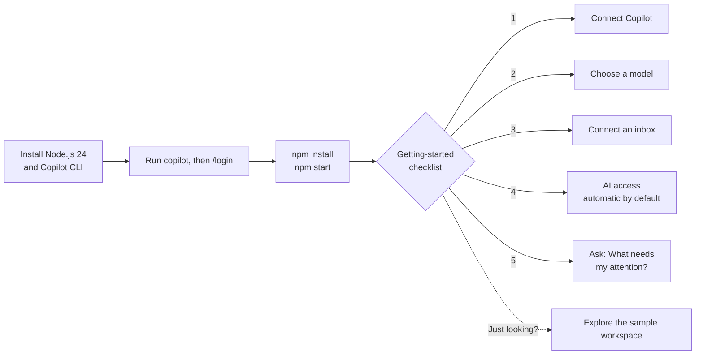
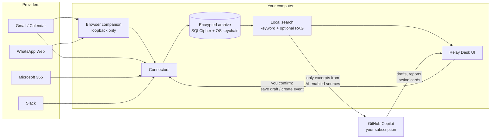

# Getting started

This guide takes you from a fresh machine to your first useful answer in about five minutes. It covers Windows, macOS and Linux.




When you open Relay Desk, the chat screen shows a **Getting started** checklist. Each step ticks itself off when the app detects it is done, so you always know what is left. Hide it with **×** at any time.


## 1. Install the prerequisites

You need three things on every platform: **Node.js 24** (`^24.13.0`), **Git**, and **one AI provider**. The steps below use the **GitHub Copilot CLI** with an active Copilot subscription; to use OpenAI Codex or Claude instead, see [Choosing another AI provider](#choosing-another-ai-provider). You don't need an OpenAI, Anthropic or other AI API key.

<details open>
<summary><strong>Windows 10/11 (x64)</strong></summary>

1. Install the official [Node.js 24 Windows x64 installer](https://nodejs.org/). MSYS/Cygwin Node builds are not supported because the SDK's native bindings crash under them.
2. Install [Git for Windows](https://git-scm.com/download/win).
3. In PowerShell:

   ```powershell
   npm install -g @github/copilot
   copilot          # then type /login and follow the browser prompt
   ```

The archive key is protected with Windows DPAPI. No extra setup is needed.
</details>

<details>
<summary><strong>macOS 13+ (Apple silicon or Intel)</strong></summary>

1. Install Node.js 24 from [nodejs.org](https://nodejs.org/) or with Homebrew: `brew install node@24`.
2. Install the Xcode command-line tools: `xcode-select --install`. They provide Git, and the compiler is used only if a native module has no prebuilt binary.
3. In Terminal:

   ```bash
   npm install -g @github/copilot
   copilot          # then type /login and follow the browser prompt
   ```

The archive key is stored with the macOS Keychain through Electron `safeStorage`. The first launch may ask for Keychain access; choose **Always Allow**.
</details>

<details>
<summary><strong>Linux (x64: Ubuntu 22.04+, Debian 12+, Fedora 39+ or similar)</strong></summary>

1. Install Node.js 24 (for example with [nvm](https://github.com/nvm-sh/nvm): `nvm install 24`) and Git.
2. Install a **Secret Service keyring** and build tools. Relay Desk refuses to start an encrypted archive without a real keyring. It never falls back to a plaintext key.

   ```bash
   # Debian/Ubuntu
   sudo apt install git build-essential python3 gnome-keyring libsecret-1-0
   # Fedora
   sudo dnf install git gcc-c++ make python3 gnome-keyring libsecret
   ```

   KDE users can use KWallet instead of GNOME Keyring. The keyring must be unlocked in your desktop session, which normally happens at login.
3. Install and sign in to the Copilot CLI:

   ```bash
   npm install -g @github/copilot
   copilot          # then type /login and follow the browser prompt
   ```
</details>

### Choosing another AI provider

Relay Desk works with three providers. Switch any time in **Settings → AI & assistant**; each remembers its own model.

| Provider | Setup | Notes |
| --- | --- | --- |
| GitHub Copilot | `npm install -g @github/copilot`, run `copilot`, type `/login` | Default. No API key. |
| OpenAI Codex | `npm install -g @openai/codex` (macOS also: `brew install --cask codex`), then `codex login` and sign in with ChatGPT | No API key. Uses your ChatGPT plan's Codex limits. Relay Desk finds `codex` on PATH and in common install folders; you can also set its full path in Settings. |
| Claude | Create an API key in the [Anthropic Console](https://console.anthropic.com/) and paste it in Settings | Billed per token by Anthropic. Anthropic does not permit third-party apps to use Claude.ai subscription sign-in, so an API key is required. The key is stored encrypted on this device. |

## 2. Get and run Relay Desk

```bash
git clone https://github.com/Ai4Innov/relaydesk.git
cd relaydesk
npm install
npm run doctor     # checks Node, Electron and native modules for your OS
npm start          # launches the app in development mode
```

`npm run doctor` prints platform-specific advice if something is missing.

### Build a desktop app (optional)

```bash
npm run make
```

| OS | Output | How to run |
| --- | --- | --- |
| Windows | `out/make/zip/win32/x64/*.zip` | Unzip and run `RelayDesk.exe`. Keep the neighbouring files together. |
| macOS | `out/make/zip/darwin/<arch>/*.zip` | Unzip and move **Relay Desk.app** to Applications. The build is unsigned, so run `xattr -dr com.apple.quarantine "/Applications/Relay Desk.app"` once, or right-click the app and choose **Open**. |
| Linux | `out/make/deb/x64/*.deb` and `out/make/zip/linux/x64/*.zip` | `sudo apt install ./out/make/deb/x64/relay-desk_*.deb`, then launch **Relay Desk** from your app menu. If you run the unzipped folder directly and Electron reports a sandbox error, run `sudo chown root:root chrome-sandbox && sudo chmod 4755 chrome-sandbox` inside it. |

CI builds the same artifacts for all three platforms on every push to `main`.

## 3. Follow the checklist

| Step | What to do | Where |
| --- | --- | --- |
| **Connect your AI provider** | Click **Connect Copilot** (or Codex/Claude if you switched). If it says you are not signed in, click **Sign in**: a terminal opens with `copilot` (type `/login`) or `codex login`. For Claude, click **Add API key**. | Chat checklist, or Settings → AI & assistant |
| **Choose a model** | Pick any model your subscription allows. You can change it later, even for a single question. | Checklist dropdown, or the model picker above the chat box |
| **Connect an inbox** | The easiest route is the **browser companion**. It reads the Gmail and Calendar tabs you already have open, with no Google Cloud setup. Other options: the Apps Script relay, the Gmail API, Microsoft 365, Slack or WhatsApp Web. | Settings → Connections |
| **AI access (automatic)** | Nothing to do. **Full access by default** is on, so every inbox, channel and calendar you connect is imported and shared with your AI provider, and this step ticks itself. To be selective, turn it off in Settings → AI & assistant, or switch off **Allow AI** on any account. WhatsApp chats stay opt-in. | Settings → Connections / AI & assistant |
| **Ask** | Try *“What needs my attention today?”* Answers cite their sources, and every write appears as a card you confirm. | Chat |

Want to look around first? On the **Connect an inbox** step, click **Explore a sample workspace** to load synthetic Gmail, Outlook, Slack and calendar data. It touches no real account.

## How your data flows



- Your messages are stored **only on your computer**, encrypted with a key held by the OS keychain (Windows DPAPI, macOS Keychain, Linux Secret Service).
- Your AI provider (GitHub, OpenAI or Anthropic) receives only relevant excerpts from AI-enabled sources: every connected account by default, or only the ones you keep enabled.
- Relay Desk **never sends email or posts to Slack**. Drafts are saved to your mailbox only when you click Save, and calendar changes happen only after you approve the exact change.

## Where things live

| | Windows | macOS | Linux |
| --- | --- | --- | --- |
| App data and archive | `%APPDATA%\Relay Desk` | `~/Library/Application Support/Relay Desk` | `~/.config/Relay Desk` |
| Archive key file | `archive-key.dpapi` | `archive-key.safestorage` | `archive-key.safestorage` |
| Default assistant workspace | `Documents\Relay Desk` | `~/Documents/Relay Desk` | `~/Documents/Relay Desk` |
| Assistant shell (when you allow it) | PowerShell | bash | bash |
| Tray icon | Notification area | Menu bar | System tray (needs AppIndicator support on GNOME) |

Set `RELAY_DATA_DIR` to use a different data folder, for example a throwaway one for testing.

## Troubleshooting

| Symptom | Fix |
| --- | --- |
| *“Copilot is not signed in”* although the CLI works | Run `copilot` in a terminal and complete `/login`, then click **Connect Copilot** again. |
| *“Codex is not signed in”* | Run `codex login` in a terminal (or click **Sign in**), finish the ChatGPT sign-in, then click **Connect**. |
| *“Codex CLI not found”* | Install it with `npm install -g @openai/codex`, or set its full path in **Settings → AI & assistant**. |
| *“Anthropic rejected the API key”* | Create a new key in the Anthropic Console and paste it in **Settings → AI & assistant**. |
| No models listed | Your subscription or organization policy may not allow SDK access. Check the Copilot settings on github.com, then click **Refresh models**. |
| Linux: *“secure storage unavailable”* at startup | Install and unlock GNOME Keyring or KWallet (see step 1), then restart Relay Desk. |
| macOS: *“app is damaged and can’t be opened”* | This is quarantine on an unsigned build. Run the `xattr` command from the table above. |
| `NODE_MODULE_VERSION` mismatch | Close the app, then run `npm rebuild better-sqlite3-multiple-ciphers`. |
| Browser companion can't import downloads on Linux | The companion expects a folder named `Downloads`. On a localized desktop, import attachments manually from the inbox. |

More detail: [browser companion](browser-mode.md), [provider setup](provider-setup.md), [privacy and permissions](privacy-and-permissions.md), [architecture](architecture.md).

## Refreshing these screenshots

The images in `docs/images` come from the synthetic sample workspace, using a throwaway data folder:

```bash
npm run package
npm run screenshots
```

If a packaged copy is already running from `out/`, Windows locks its files. Build to another folder instead; the script looks in `RELAY_OUT_DIR` too:

```bash
RELAY_OUT_DIR=/tmp/relay-out npm run package
RELAY_OUT_DIR=/tmp/relay-out npm run screenshots
```
